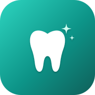
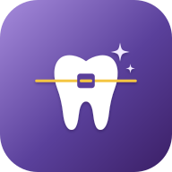

  
  &nbsp;&nbsp;
  

<h1 align="center">SmilePilot</h1>

<b>Your AI co-pilot for the dental clinic — on your phone, free and private.</b> 
Android & iPhone · works offline · X-ray AI on the device · orthodontic tracking · optional AI agent

---

SmilePilot runs a whole dental practice from a phone: patients, visits, an anatomical tooth chart, on-device X-ray AI
with tooth numbering, prescriptions with safety checks, case records and WhatsApp messages (English / Hindi / Marathi),
bills, appointments and backups. **No server, no account, no subscription** — patient data never leaves the phone.

Each clinic gets its own build with its own name, colours and icon:

| | **SmilePilot** — Dr. Sowmya B. | **Brace Place** — Dr. Abhidnya Yeole |
|---|---|---|
| Practice | General dentistry & oral surgery | Orthodontics (braces, aligners, Invisalign) — Balewadi, Pune |
| Phone | Android (APK) | iPhone (web app, Add to Home Screen) |
| Theme | Teal | Lavender & white, DM Sans |
| Extras | — | Aligner schedule & reminders, ortho exam, progress photos, ortho care sheets |

### Highlights

- **X-ray AI on the phone** — finds fillings, crowns, RCTs, implants, impacted teeth, caries, periapical lesions, bone loss…
  and numbers the teeth (FDI). ~1–2 s on Android (native ONNX Runtime).
- **Human-in-the-loop** — the dentist confirms or rejects each finding; the app learns her thresholds and exports a
  verified dataset to retrain the model ([`training/`](training/)).
- **Orthodontics** — aligner X of Y, next change date, "changes due" list with one-tap WhatsApp reminders.
- **Optional Pro AI agent** — with the dentist's own Claude API key, an assistant that can search patients, read records,
  summarise the clinic, book appointments and update aligners (always asking first).

### Repository

| Path | |
|---|---|
| [`app/`](app/) | The app (React + TypeScript + Capacitor): Android & iOS projects, per-clinic presets and brands |
| [`training/`](training/) | Training & evaluation of the on-device X-ray models, human-in-the-loop fine-tuning |
| [`notebooks/`](notebooks/) | Same training as a Kaggle/Colab notebook |
| [`docs/INSTALL.md`](docs/INSTALL.md) | Install guide for dentists |

### Model accuracy (held-out test films)

Tooth numbering **94.5% mAP50** · findings **65% mAP50** (implant 96, impacted 94, RCT 93, filling 77, caries 53).
Caries on films from new clinics is the weak spot — see [`training/README.md`](training/README.md).

> SmilePilot is a decision-support tool. AI findings can be wrong or incomplete and must be verified clinically.

X-ray models trained with Ultralytics YOLOv8 (AGPL-3.0) on the public 14-class panoramic dataset and DENTEX (CC BY 4.0, Hamamci et al. 2023).
